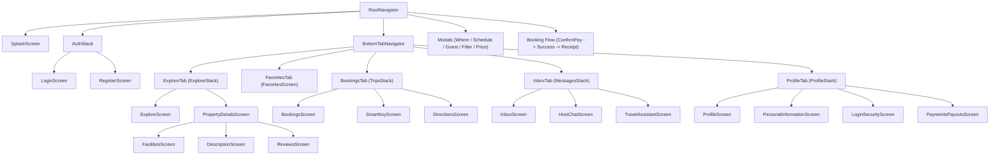

# 🏨 WanderStay - Ứng dụng đặt phòng du lịch (React Native + Expo)

Dự án môn học React Native được chuẩn hóa theo kiến trúc **Feature-based (Domain-driven)** chuyên nghiệp, khớp chính xác 100% với toàn bộ **28 màn hình thiết kế (PNG)** tại thư mục `D:\Travelling`.

Dự án phục vụ 2 nhóm đối tượng người dùng chính: **Khách vãng lai (Guest)** và **Khách hàng thành viên (Member)**.

---

## 🛠 Công nghệ & Thư viện sử dụng
- **Nền tảng:** [Expo SDK 58](https://expo.dev/) + [TypeScript](https://www.typescriptlang.org/) (Strict mode, 0 lỗi type-check)
- **UI Framework:** [Tamagui](https://tamagui.dev/) v3 + `@tamagui/lucide-icons` + `@tamagui/font-inter`
- **Hệ thống điều hướng:** [React Navigation v7](https://reactnavigation.org/) (`@react-navigation/native-stack` + `@react-navigation/bottom-tabs`) với cấu trúc **Nested Sub-Stacks** theo từng Tab
- **Backend & Database:** [Supabase](https://supabase.com/) (`@supabase/supabase-js` + `@react-native-async-storage/async-storage`)

---

## 📁 Cấu trúc thư mục chuẩn (Feature-based Architecture)

```text
wanderstay-app/
├── assets/                         # Icons, Splash và static assets
├── src/
│   ├── features/                   # 8 Phân hệ nghiệp vụ (Domain-driven)
│   │   ├── auth/screens/           # Xác thực người dùng (Splash, Login, Register)
│   │   ├── explore/screens/        # Khám phá, Tìm kiếm, Lọc (Trang chủ & 6 Modals/Screens lọc)
│   │   ├── detail/screens/         # Chi tiết chỗ nghỉ, Dịch vụ, Mô tả, Đánh giá
│   │   ├── booking/screens/        # Đặt phòng, Xác nhận thanh toán, Hóa đơn (PDF)
│   │   ├── trips/screens/          # Quản lý chuyến đi, Chìa khóa thông minh, Chỉ đường
│   │   ├── messages/screens/       # Hộp thư, Trò chuyện chủ nhà, Trợ lý ảo AI
│   │   ├── favorites/screens/      # Danh sách yêu thích / wishlist
│   │   └── profile/screens/        # Hồ sơ, Thông tin cá nhân, Bảo mật, Thanh toán
│   ├── navigation/                 # Kiến trúc điều hướng đa tầng
│   │   ├── RootNavigator.tsx       # Root Stack (Splash -> Auth -> MainTabs + Global Modals/Flows)
│   │   ├── BottomTabNavigator.tsx  # 5 Bottom Tabs (Explore, Favorites, Bookings, Inbox, Profile)
│   │   └── stacks/                 # Các Sub-Stack điều hướng độc lập
│   │       ├── AuthStack.tsx       # Sub-Stack: Login -> Register
│   │       ├── ExploreStack.tsx    # Sub-Stack: Explore -> PropertyDetails
│   │       ├── TripsStack.tsx      # Sub-Stack: Bookings -> SmartKey -> Directions
│   │       ├── MessagesStack.tsx   # Sub-Stack: Inbox -> HostChat -> TravelAssistant
│   │       └── ProfileStack.tsx    # Sub-Stack: Profile -> PersonalInfo / Security / Payments
│   ├── services/
│   │   └── supabase.ts             # Khởi tạo Supabase client
│   └── types/
│       ├── database.ts             # TypeScript definitions cho CSDL (Properties, Bookings,...)
│       └── navigation.ts           # Type-safe navigation params cho tất cả Stacks & Tabs
├── App.tsx                         # Root component (SafeAreaProvider, TamaguiProvider, NavigationContainer)
├── tamagui.config.ts               # Cấu hình Tamagui v5 + Inter font
├── supabase_schema.sql             # Script SQL tạo schema CSDL và dữ liệu mẫu WanderStay
└── tsconfig.json                   # Cấu hình TypeScript với path alias @/* -> ./src/*
```

---

## 🗺 Bản đồ liên kết đầy đủ 28 màn hình & file thiết kế PNG

| STT | Phân hệ (Domain) | Tên màn hình React Native | Đường dẫn file code | File thiết kế PNG (`D:\Travelling`) |
|:---:|---|---|---|---|
| 1 | **auth** | SplashScreen | `src/features/auth/screens/SplashScreen.tsx` | `Logo Loading.png` |
| 2 | **auth** | LoginScreen | `src/features/auth/screens/LoginScreen.tsx` | `Login.png` |
| 3 | **auth** | RegisterScreen | `src/features/auth/screens/RegisterScreen.tsx` | `Register.png` |
| 4 | **explore** | ExploreScreen | `src/features/explore/screens/ExploreScreen.tsx` | `index.png` |
| 5 | **explore** | WhereModal | `src/features/explore/screens/WhereModal.tsx` | `where.png` |
| 6 | **explore** | ScheduleModal | `src/features/explore/screens/ScheduleModal.tsx` | `Schaduel.png` |
| 7 | **explore** | GuestModal | `src/features/explore/screens/GuestModal.tsx` | `guest.png` |
| 8 | **explore** | FilterModal | `src/features/explore/screens/FilterModal.tsx` | `fillter.png` |
| 9 | **explore** | PriceRangeModal | `src/features/explore/screens/PriceRangeModal.tsx` | `Price range.png` |
| 10 | **explore** | FilterResultScreen | `src/features/explore/screens/FilterResultScreen.tsx` | `Apply fillter.png` |
| 11 | **detail** | PropertyDetailsScreen | `src/features/detail/screens/PropertyDetailsScreen.tsx` | `Property details.png` |
| 12 | **detail** | FacilitiesScreen | `src/features/detail/screens/FacilitiesScreen.tsx` | `Facilities & Services.png` |
| 13 | **detail** | DescriptionScreen | `src/features/detail/screens/DescriptionScreen.tsx` | `Description.png` |
| 14 | **detail** | ReviewsScreen | `src/features/detail/screens/ReviewsScreen.tsx` | `Reviews.png` |
| 15 | **booking** | ConfirmAndPayScreen | `src/features/booking/screens/ConfirmAndPayScreen.tsx` | `Confirm and pay.png` |
| 16 | **booking** | PaymentSuccessScreen | `src/features/booking/screens/PaymentSuccessScreen.tsx` | `Payment success.png` |
| 17 | **booking** | TripReceiptScreen | `src/features/booking/screens/TripReceiptScreen.tsx` | `Trip Receipt - WanderStay.png` |
| 18 | **trips** | BookingsScreen | `src/features/trips/screens/BookingsScreen.tsx` | `Bookings - WanderStay.png` |
| 19 | **trips** | SmartKeyScreen | `src/features/trips/screens/SmartKeyScreen.tsx` | `Check-in & Smart Key - Balian Treehouse.png` |
| 20 | **trips** | DirectionsScreen | `src/features/trips/screens/DirectionsScreen.tsx` | `Directions & Arrival - Balian Treehouse.png` |
| 21 | **messages** | InboxScreen | `src/features/messages/screens/InboxScreen.tsx` | `Inbox - WanderStay.png` |
| 22 | **messages** | HostChatScreen | `src/features/messages/screens/HostChatScreen.tsx` | `Host Chat - Wayan Sutama (Balian Treehouse).png` |
| 23 | **messages** | TravelAssistantScreen | `src/features/messages/screens/TravelAssistantScreen.tsx` | `7 Assistant.png` |
| 24 | **favorites** | FavoritesScreen | `src/features/favorites/screens/FavoritesScreen.tsx` | `favouries.png` |
| 25 | **profile** | ProfileScreen | `src/features/profile/screens/ProfileScreen.tsx` | `Profile - WanderStay.png` |
| 26 | **profile** | PersonalInformationScreen | `src/features/profile/screens/PersonalInformationScreen.tsx` | `Personal Information - WanderStay.png` |
| 27 | **profile** | LoginSecurityScreen | `src/features/profile/screens/LoginSecurityScreen.tsx` | `Login & Security - WanderStay.png` |
| 28 | **profile** | PaymentsPayoutsScreen | `src/features/profile/screens/PaymentsPayoutsScreen.tsx` | `Payments & Payouts - WanderStay.png` |

---

## 🧭 Cấu trúc luồng điều hướng (Navigation Flow)



---

## 🚀 Hướng dẫn phát triển UI

### 1. Khởi chạy ứng dụng
Mở terminal tại thư mục `D:\Travelling\wanderstay-app`:
```bash
npx expo start
```
- Quét mã QR bằng ứng dụng **Expo Go** trên điện thoại thật (Android/iOS).
- Hoặc bấm `a` trên bàn phím để mở trên máy ảo Android Emulator.

### 2. Bắt đầu tự code giao diện
Mỗi màn hình trong thư mục `src/features/<feature>/screens/` hiện đã được tạo sẵn khung (skeleton) với:
- Tên màn hình hiển thị ở giữa
- Tên file thiết kế PNG tham chiếu chính xác
- Khai báo đầy đủ trong TypeScript Navigation types

Bạn chỉ cần mở từng file trong `src/features/` và tự do code giao diện với các component của **Tamagui** (`YStack`, `XStack`, `Card`, `Button`, `Input`, `Image`, v.v.) hoặc **React Native** cơ bản.
